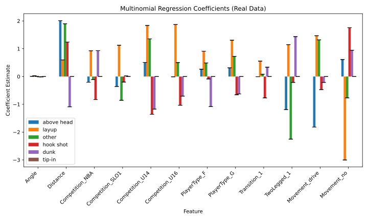

# GLM Basketball Shots

Multinomial and ordinal logistic regression, implemented with NumPy and SciPy, and applied to a dataset of basketball shots. Coefficient uncertainty is estimated with bootstrapping, and both models are also checked on synthetic data from a known data-generating process.



## Files

- `solution.py`: the multinomial and ordinal logistic regression models
- `test_lr.py`: unit tests for both models
- `analysis.py`: fits the models to the real and synthetic data, with bootstrapped confidence intervals
- `dataset.csv`: basketball shot data

## Running it

```bash
git clone https://github.com/alihawk/glm-basketball-shots.git
cd glm-basketball-shots
pip install -r requirements.txt
python test_lr.py
python analysis.py
```
